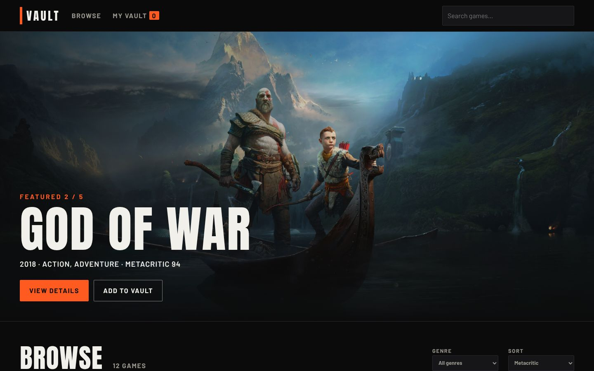

# VAULT — AAA Game Explorer

A small web app for browsing big-budget story games (Red Dead Redemption 2, The Last of Us Part II, God of War, GTA and more) using the [RAWG](https://rawg.io/apidocs) games API. Search any game, filter and sort the results, open a detail view, and keep your own **Vault** (Wishlist / Playing / Finished) that is saved in the browser.

Built with plain **HTML, CSS and JavaScript** (about 600 lines). No frameworks, no build step.

**Live demo:** https://vault-aaa-games.vercel.app/ (also on GitHub Pages: https://tahasanurkarim-pixel.github.io/vault-aaa-games/)

## Features

- **Hero**: the top 5 games rotate every 6 seconds, pause on hover, and the ← → keys move them.
- **Browse**: 12 games per load. Live search (waits 400 ms after you stop typing), plus a genre filter and a sort (Metacritic, rating, newest, name).
- **Detail view**: picture, description and up to 8 info fields. Close it with Esc, the ✕ button or the backdrop.
- **My Vault**: Wishlist / Playing / Finished tabs and a stats line.
- **Recently viewed**: the last 8 games you opened.
- **Remembers**: your Vault, recently viewed games, and the last genre and sort you picked.
- **States**: loading (skeleton cards), error (message + Retry), empty (message + Clear filters).

## Run locally

Double-click `index.html`, or serve the folder (e.g. VS Code Live Server, or `python3 -m http.server 8000` and open http://localhost:8000). The RAWG key is already in `js/config.js`.

## Files

| File | Lines | What it does |
|---|---|---|
| `index.html` | 90 | Page layout |
| `css/style.css` | 111 | Styles. Colours and fonts are set as variables at the top |
| `js/config.js` | 4 | API key and settings |
| `js/api.js` | 35 | All `fetch` calls to RAWG |
| `js/storage.js` | 48 | All `localStorage` reads and writes |
| `js/app.js` | 318 | State, rendering and event listeners |

## Rubric mapping

| Requirement | Where |
|---|---|
| **DOM manipulation (4)** | `app.js`: `createCard` and `createElement` build every card with `document.createElement`, `dataset` and `append`. `renderCards`, `renderBrowse`, `renderHero`, `renderVault` and `renderRecent` redraw the page. `innerHTML` is only used with `escapeHTML` (`renderDetail`, `showMessage`). |
| **Events & JS logic (3)** | `app.js` "events" section. **click**: cards, tabs, hero buttons, modal. **input**: debounced search. **change**: genre and sort. **submit**: search form. **keydown**: Esc closes the detail view, ← → move the hero. **Event delegation**: `handleCardClick` and the `modalBody` listener. **Array methods**: `map` (`renderDetail`), `filter` + `sort` (`renderBrowse`), `forEach` (`renderCards`), `find` (`findGame`), `some` (`isInVault`), `reduce` (`renderVault` stats). |
| **API & async (4)** | `api.js`: `request` uses `fetch` + `async/await` + `try/catch` and checks `response.ok`. `getGames` and `getGameDetails` call it. `app.js`: `loadGames` uses `AbortController` so a new search cancels the old one, and shows skeleton cards, an error message with Retry, or an empty message with Clear filters. |
| **localStorage (3)** | `storage.js`: the Vault (`getVault`, `setStatus`, `removeFromVault`), recently viewed (`addRecent`, max 8), and saved filters (`getPrefs`, `savePrefs`). `load` wraps `JSON.parse` in `try/catch`. |

## Credits

Game data and images come from [RAWG](https://rawg.io). The fonts are Anton and Barlow from Google Fonts.
